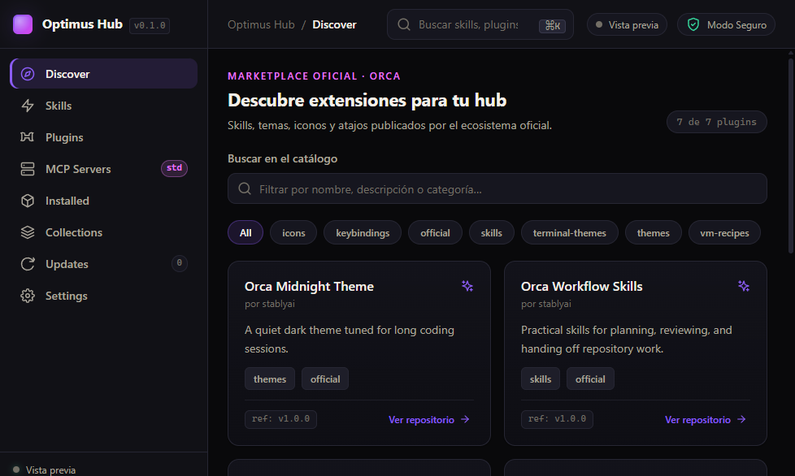

# Optimus Hub

A marketplace panel for [Orca ADE](https://www.onorca.dev): Agent Skills, Orca plugins and MCP servers in one place.



## What it does

Orca already ships the pieces — `orca skills install`, a plugin index, the MCP registry — but they live in different places and different commands. Optimus Hub puts them in one panel:

- **Discover** — the official plugin index, searchable by name and category.
- **Skills** — Orca's installable skills, with global or per-project scope.
- **MCP Servers** — the reference MCP servers, with their exact run command.
- **Installed / Updates** — runs the official maintenance commands for you.
- **Collections** — packs that queue several skills at once.
- **Settings** — what the plugin is allowed to do, and what it isn't.

Installs are never silent. The panel writes the exact command into a terminal you pick, and confirms it before pressing Enter. You see it happen.

## Install

One repository serves both roles: it contains the plugin and the marketplace index.

### From the marketplace (recommended — this is what enables updates)

1. In Orca: **Settings → Plugins → Manage sources**.
2. Add this repository:

```
https://github.com/aikogxstudios/optimus-hub-plugin.git
```

3. **Refresh**, then install **Optimus Hub** and approve its permissions.

Installed this way, Orca records the plugin as `kind: marketplace` and shows **Check for update** when a new tag is published.

### Directly from this repository

**Settings → Plugins → Install plugin → Git URL**:

```
https://github.com/aikogxstudios/optimus-hub-plugin#v0.2.0
```

The `#ref` is required. A direct install stays pinned to that tag and **does not** receive update checks — use the marketplace path if you want updates.

### Verifying the install mode

`%APPDATA%\Orca\plugins\plugins.lock.json` records how each plugin was installed. The entry should look like:

```json
"optimus.optimus-hub": {
  "source": { "kind": "marketplace" }
}
```

`"kind": "git"` means a direct install: it works, but it will never report an update.

### From source

```
npm install
npm run package:plugin
```

Add `dist/plugin-repo` as a development plugin in **Settings → Plugins → Development**.

## Permissions

| Capability | Why |
| --- | --- |
| `workspace:read` | Show the active workspace and its terminals. |
| `notifications:show` | Confirm when a command was sent. |
| `terminal:send` | Write a command into a terminal you choose. |

The panel has no network and no filesystem access. Its iframe runs with `connect-src 'none'`, and the bundle is a single self-contained HTML file so nothing is fetched at runtime.

## Build

```
npm install
npm run build:plugin    # typecheck + panel bundle
npm test                # catalog parsing and command builders
npm run package:plugin  # dist/plugin-repo, ready to publish
```

Node 20 or newer.

## License

MIT. See [LICENSE](LICENSE).
